<!-- Bannière -->

 

Fianarantsoa, Madagascar &nbsp;|&nbsp; Master's student at École Nationale d'Informatique (ENI)

 

 

## About

I bridge product vision and engineering execution.

As **Product Owner on two projects**, I turn business needs into clear requirements and a prioritized backlog. As a **DevOps engineer**, I build the automated pipelines and container platforms that ship the result reliably. As a **developer**, I design microservices and AI-powered services, with **Python** as my language of choice.

 

## Areas of Expertise

<table>
  <tr>
    <td width="50%" valign="top">

**Product Ownership**
 
Requirements, specifications, stakeholder alignment
 
Backlog, user stories, acceptance criteria, prioritization
 
Agile / Scrum ceremonies and delivery tracking
  

  </td>
    <td width="50%" valign="top">

**DevOps & CI/CD**
 
Pipelines with Jenkins and GitHub Actions
 
Docker containerization, Kubernetes orchestration
 
DevSecOps: automated tests, security scans, controlled deployments
  

  </td>
  </tr>
  <tr>
    <td width="50%" valign="top">

**Architecture & Backend**
 
Microservices, module separation, REST API design
 
Backend services with FastAPI, NestJS, Spring Boot
  

  </td>
    <td width="50%" valign="top">

**AI & LLM Engineering**
 
LLM-based models and AI agents
 
MLOps: training, packaging, API exposure (FastAPI / Swagger), containerized deployment
  

  </td>
  </tr>
</table>

 

## Technical Stack

**Languages**
 

**Frontend**
 

**Backend**
 

**DevOps & CI/CD**
 

**Databases**
 

**AI / ML & Tools**
 

&nbsp;

 

## Delivery Workflow

 

## GitHub Statistics

<picture>
  <source media="(prefers-color-scheme: dark)" srcset="https://github-readme-stats.vercel.app/api?username=Evil-Ghoster&show_icons=true&theme=tokyonight&hide_border=true&bg_color=0D1117&title_color=58A6FF&icon_color=58A6FF&text_color=C9D1D9" />
  <source media="(prefers-color-scheme: light)" srcset="https://github-readme-stats.vercel.app/api?username=Evil-Ghoster&show_icons=true&hide_border=true&title_color=0969DA&icon_color=0969DA" />
  
</picture>
<picture>
  <source media="(prefers-color-scheme: dark)" srcset="https://github-readme-stats.vercel.app/api/top-langs/?username=Evil-Ghoster&layout=compact&theme=tokyonight&hide_border=true&bg_color=0D1117&title_color=58A6FF&text_color=C9D1D9" />
  <source media="(prefers-color-scheme: light)" srcset="https://github-readme-stats.vercel.app/api/top-langs/?username=Evil-Ghoster&layout=compact&hide_border=true&title_color=0969DA" />
  
</picture>

 

<i>From product vision to production: define, build, automate, deliver.</i>

