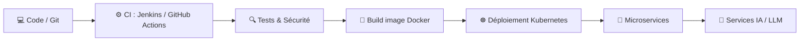

# 👋 Salut ! Moi c'est Onja

<div align="center">

[](https://git.io/typing-svg)

</div>

---

## 🧑‍💻 À propos

> **Product Owner, Développeur Fullstack & Ingénieur DevOps** 
> Je conçois, j'automatise et je livre des produits fiables — de la vision produit jusqu'à la production.
> Étudiant en Master d'informatique à l'**École Nationale d'Informatique (ENI) de Fianarantsoa** 🇲🇬

```python
class Onja:
    location = "Madagascar 🇲🇬"
    education = "Master Informatique — ENI Fianarantsoa"
    roles = ["Product Owner", "Fullstack Developer", "DevOps Engineer", "AI Engineer"]
    favorite_language = "Python 🐍"
    architecture = ["Microservices", "API REST", "Event-driven"]
    current_focus = [
        "Piloter 2 projets en tant que Product Owner",
        "Industrialiser des pipelines CI/CD DevSecOps",
        "Concevoir des agents IA et des applications LLM",
    ]
    motto = "Build, automate, ship."
```

---

## 🎯 Ce que je fais

### 📋 Product Owner
Je porte la vision produit de **deux projets** : recueil et priorisation des besoins, rédaction de cahiers des charges, gestion du backlog, user stories, critères d'acceptation, animation des cérémonies agiles (Scrum) et coordination entre équipe technique et parties prenantes.

### ⚙️ DevOps & CI/CD
Conception et maintenance de pipelines **CI/CD** complets avec **Jenkins** et **GitHub Actions**, conteneurisation avec **Docker**, orchestration avec **Kubernetes**, intégration de la sécurité dans la chaîne (**DevSecOps**).

### 🧩 Architecture & Services
Développement de services backend et conception d'**architectures microservices** (découplage des modules, API REST, communication inter-services, déploiement indépendant).

### 🤖 IA, Agents & LLM
Développement de **modèles LLM**, conception d'**agents IA**, pipeline **MLOps** (entraînement, packaging, API **FastAPI** / Swagger, conteneurisation et déploiement).

---

## 🛠️ Stack technologique

<div align="center">

### 🐍 Langage préféré


### 🤖 IA & MLOps


### ⚙️ DevOps & CI/CD


### 🧱 Backend & Microservices


### 🖥️ Frontend


### 🗄️ Bases de données


### 🔧 Outils


</div>

---

## 🧭 Compétences clés

| Domaine | Compétences |
|---|---|
| **Product Management** | Backlog, user stories, roadmap, priorisation, cahier des charges, Scrum, recueil des besoins |
| **DevOps / CI-CD** | Jenkins, GitHub Actions, pipelines DevSecOps, Docker, Kubernetes, automatisation du déploiement |
| **Architecture** | Microservices, API REST, séparation des modules, conception de services |
| **IA / LLM** | Agents IA, développement de modèles LLM, MLOps, API FastAPI, déploiement de modèles |
| **Développement** | Python, TypeScript, NestJS, Vue.js, React, Java / Spring Boot |

---

## 🌐 Architecture type que je mets en place



---

<div align="center">

**Du code au déploiement, du besoin au produit : je construis, j'automatise et je livre.** 🚀

</div>

---

## 🤝 Connectons-nous !

<div align="center">

[](votre-portfolio.com)
[](votre-linkedin)
[](mailto:onjanirinarakotondranaivo@gmail.com)
[](https://github.com/Evil-Ghoster)
[](https://wa.me/+261384031028)

</div>

---

## 📊 Statistiques GitHub

<div align="center">


N'hésitez pas à ⭐ mes projets s'ils vous plaisent !

</div>

---

<div align="center">
  
</div>

<div align="center">
  
</div>
