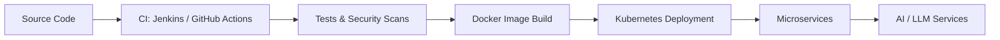

# Ghoster

### Product Owner · DevOps Engineer · Fullstack & AI Developer

Fianarantsoa, Madagascar · Master's student at École Nationale d'Informatique (ENI), Fianarantsoa

---

## About

I bridge product vision and engineering execution. As **Product Owner on two projects**, I turn business needs into clear requirements and a prioritized backlog. As a **DevOps engineer**, I build the automated pipelines and container platforms that ship the result reliably. As a **developer**, I design microservices and AI-powered services, with Python as my language of choice.

---

## Areas of Expertise

### Product Ownership
- Requirements gathering, specifications, and stakeholder alignment
- Backlog management, user stories, acceptance criteria, and prioritization
- Agile / Scrum ceremonies and delivery tracking

### DevOps & CI/CD
- Pipeline design and automation with **Jenkins** and **GitHub Actions**
- Containerization with **Docker**; orchestration with **Kubernetes**
- DevSecOps practices: automated testing, security scanning, and controlled deployments

### Architecture & Backend
- **Microservices** architecture, module separation, and REST API design
- Backend services with **Python (FastAPI)**, **NestJS**, and **Spring Boot**

### AI & LLM Engineering
- Development and deployment of **LLM-based** models and **AI agents**
- MLOps workflow: training, packaging, API exposure (FastAPI / Swagger), containerized deployment

---

## Technical Stack

| Category | Technologies |
|---|---|
| **Languages** | Python (primary), TypeScript, JavaScript, Java |
| **AI / ML** | LLMs, AI agents, PyTorch, Hugging Face, LangChain |
| **Backend** | FastAPI, NestJS, Node.js, Spring Boot, Express.js |
| **Frontend** | Vue.js, React, HTML5, CSS3 |
| **DevOps** | Jenkins, GitHub Actions, GitLab CI, Docker, Kubernetes, Linux |
| **Databases** | PostgreSQL, MySQL, SQLite |
| **Tools** | Git, GitHub, GitLab, VS Code |

---

## Delivery Workflow

---

## GitHub Statistics

---

*From product vision to production: define, build, automate, deliver.*

